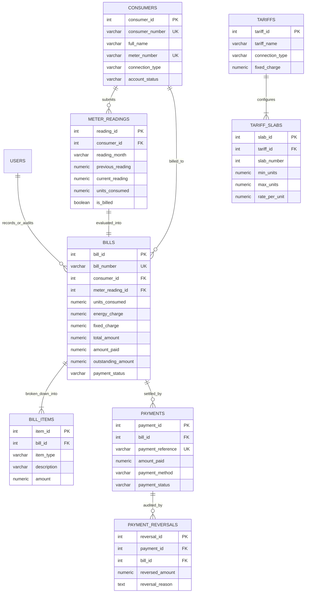

# Electricity Billing and Consumption Management System (DBMS Mini Project)

An enterprise-grade, normalized relational database web application built for college DBMS practicals, project demonstrations, and viva voce examinations.

Developed using **PostgreSQL**, **Python (Flask)**, **psycopg2**, **Chart.js**, and vanilla **HTML5/CSS3/JavaScript**.

---

## Table of Contents
1. [Project Abstract](#1-project-abstract)
2. [Problem Statement](#2-problem-statement)
3. [Objectives](#3-objectives)
4. [Existing System vs Proposed System](#4-existing-system-vs-proposed-system)
5. [Hardware and Software Requirements](#5-hardware-and-software-requirements)
6. [Technology Stack](#6-technology-stack)
7. [Entity-Relationship (ER) Diagram](#7-entity-relationship-er-diagram)
8. [Relational Schema & Table Descriptions](#8-relational-schema--table-descriptions)
9. [Database Normalization (1NF, 2NF, 3NF)](#9-database-normalization)
10. [Database Functions, Procedures, Triggers & Views](#10-database-functions-procedures-triggers--views)
11. [Important SQL Queries with Comments](#11-important-sql-queries-with-comments)
12. [Installation & Setup Guide (PostgreSQL & pgAdmin 4)](#12-installation--setup-guide)
13. [Running the Application](#13-running-the-application)
14. [Running the Test Suite](#14-running-the-test-suite)
15. [Limitations & Future Enhancements](#15-limitations--future-enhancements)

---

## 1. Project Abstract

The **Electricity Billing and Consumption Management System** is a full-stack database application designed to manage the core operations of an electricity distribution utility. The system models electricity consumers across Domestic, Commercial, and Industrial categories, logs monthly meter dial readings, automatically computes kilowatt-hour consumption, evaluates progressive tiered slab charges with standing maintenance fees and electricity duties, generates official printable invoices, collects full/partial payments, and produces analytical consumption reports.

The database is built on **PostgreSQL** in compliance with **Third Normal Form (3NF)** with explicit primary and foreign keys, check constraints, B-Tree indexes, stored procedures with row-level pessimistic locking (`FOR UPDATE`), database triggers, and pre-aggregated analytical views that prevent Cartesian join multiplication errors.

---

## 2. Problem Statement

Conventional manual electricity meter recording and billing suffers from numerous operational and relational deficiencies:
- **Calculation Inaccuracies:** Manual slab billing calculations often lead to billing errors and consumer disputes.
- **Data Redundancy & Anomalies:** Lack of relational constraints allows duplicate meter entries and invalid negative readings.
- **Financial Race Conditions:** Concurrent payment processing without concurrency control results in overpayments beyond invoice balances.
- **Audit Deficiencies:** Hard deletions of payments or changing tariff schedules corrupts historical financial records.
- **Lack of Real-Time Analytics:** Management lacks immediate insight into aggregate monthly consumption, revenue collection efficiency, and abnormal consumption surges.

---

## 3. Objectives

- **Automated Usage Calculation:** Automatically derive units consumed ($Usage = Current - Previous$) and enforce validation via triggers.
- **Configurable Progressive Slab Billing:** Dynamically evaluate tiered progressive tariffs without altering application source code.
- **Financial Integrity & Snapshot Immutability:** Store itemized charge breakdowns with each bill so historical bills remain unaltered by future tariff policy updates.
- **Concurrency-Safe Payment Collections:** Guarantee atomic settlements using row-level locking (`SELECT ... FOR UPDATE`) and support partial settlements.
- **Auditability:** Provide audited payment cancellations without hard-deleting transactions.
- **Analytical Reporting:** Deliver insights on monthly consumption trends, collection efficiency, top consumers, and anomaly spikes (>30% surge) using SQL aggregation and CTEs.

---

## 4. Existing System vs Proposed System

| Feature | Existing Manual / Spreadsheet System | Proposed PostgreSQL System |
| :--- | :--- | :--- |
| **Data Storage** | Spreadsheets / Flat Files | Normalized PostgreSQL Relational Database (3NF) |
| **Data Validation** | Manual / Vulnerable to Typos | Enforced via CHECK constraints and BEFORE triggers |
| **Slab Calculation** | Manual arithmetic prone to errors | Automated progressive stored function in PL/pgSQL |
| **Historical Invoices** | Tariff changes rewrite past calculations | Immutable financial snapshot preserved in `bill_items` |
| **Concurrency Control** | High risk of duplicate / overpayments | Pessimistic Row Locking (`SELECT ... FOR UPDATE`) |
| **Audit Mechanism** | Deleted rows leave no trail | Immutable `payment_reversals` audit ledger |
| **Reporting** | Time-consuming manual aggregation | Instant SQL views with CTEs and Window Functions |

---

## 5. Hardware and Software Requirements

### Hardware Requirements
- **Processor:** Intel Core i3 / AMD Ryzen 3 or higher
- **RAM:** Minimum 4 GB (8 GB recommended)
- **Disk Space:** 500 MB free hard disk space
- **Display:** $1280 \times 720$ resolution minimum (responsive on mobile and tablets)

### Software Requirements
- **Operating System:** Windows 10/11, Linux (Ubuntu/Debian), or macOS
- **Database Server:** PostgreSQL 14, 15, or 16
- **Database Management Tool:** pgAdmin 4 or `psql` command-line utility
- **Runtime Environment:** Python 3.10, 3.11, or 3.12
- **Web Browser:** Google Chrome, Mozilla Firefox, Microsoft Edge, or Safari

---

## 6. Technology Stack

- **Frontend:** HTML5, CSS3, JavaScript (Vanilla ES6+)
- **CSS Styling:** Modern Navy-Blue (`#0f172a`) & Electric-Green (`#10b981`) Palette, Responsive Grid, Flexbox
- **Icons:** Font Awesome 6
- **Data Visualizations:** Chart.js 4.4
- **ER Diagram Renderer:** Mermaid.js
- **Backend Framework:** Python 3 with Flask 3.x
- **Database Client:** `psycopg2-binary` (PEP 249 compliant) with parameterized queries
- **Security:** Cryptographic password hashing (`scrypt` / PBKDF2 via `werkzeug.security`)
- **Testing:** `pytest` unit, route, and relational integrity test suite

---

## 7. Entity-Relationship (ER) Diagram



---

## 8. Relational Schema & Table Descriptions

The database name is `electricity_billing_db`. It consists of 9 normalized relational tables:

1. **`users`:** Administrative and operator staff authentication credentials, password hashes, and system permissions.
2. **`consumers`:** Registered electricity customers, connection categories (`DOMESTIC`, `COMMERCIAL`, `INDUSTRIAL`), unique meter identifiers, and soft-delete account status (`ACTIVE`, `INACTIVE`).
3. **`tariffs`:** Master catalog of pricing policies and standing monthly meter maintenance charges.
4. **`tariff_slabs`:** Tiered progressive consumption brackets (`min_units`, `max_units`, `rate_per_unit`) belonging to a tariff.
5. **`meter_readings`:** Monthly physical meter dial measurements. Enforces non-negative readings and positive consumption math.
6. **`bills`:** Monthly electricity invoices calculated progressively. Stores financial snapshots of energy charge, standing charge, tax, total, paid, and outstanding amounts.
7. **`bill_items`:** Itemized breakdown of each progressive tier slab applied to the invoice, ensuring transparency and historical auditing.
8. **`payments`:** Collection ledger recording full and partial payments across payment methods (`CASH`, `UPI`, `BANK_TRANSFER`, `NET_BANKING`, `DEBIT_CARD`).
9. **`payment_reversals`:** Immutable audit log documenting authorized payment cancellations and reasons.

---

## 9. Database Normalization

Our relational database design adheres strictly to **Third Normal Form (3NF)**:

### First Normal Form (1NF)
- Every column holds atomic, indivisible values (e.g. single phone number, individual meter number).
- No repeating groups or comma-separated lists.
- Every row is identified by a unique surrogate primary key.

### Second Normal Form (2NF)
- The relations are in 1NF.
- All non-prime attributes are fully functionally dependent on the entire primary key. Because single-column primary keys (`consumer_id`, `reading_id`, `bill_id`) are utilized, partial functional dependencies are mathematically impossible.

### Third Normal Form (3NF)
- The relations are in 2NF.
- There are no transitive functional dependencies ($X \rightarrow Y$ where $Y \rightarrow Z$ and $X$ is primary key).
- Slabs depend strictly on `tariff_id`; rates are not duplicated on consumer profiles.

### Intentional Financial Denormalization (Audit Snapshots)
In financial engineering, bills must not recompute their historical totals dynamically from live tariff tables. The `bills` and `bill_items` tables deliberately store calculated monetary snapshots at the time of invoice issuance so that future tariff revisions cannot retroactively alter past financial statements.

---

## 10. Database Functions, Procedures, Triggers & Views

All database logic is implemented in native PostgreSQL scripts in the `database/` folder:

### Stored Functions (`04_functions.sql`)
- `fn_calculate_units_consumed(prev, curr)`: Validates readings and computes usage.
- `fn_calculate_progressive_slabs(tariff_id, units)`: Iteratively evaluates progressive consumption brackets and returns a tabular breakdown.
- `fn_generate_bill_number(period)`: Generates structured invoice identifiers (`BILL-YYYYMM-XXXX`).
- `fn_generate_payment_reference()`: Generates unique receipt codes (`RCPT-YYYYMMDD-XXXX`).

### Stored Procedures (`05_procedures.sql`)
- `sp_generate_monthly_bill(reading_id, due_days)`: Atomically evaluates progressive slabs, creates invoice record, populates `bill_items`, and marks reading as billed in an ACID transaction.
- `sp_record_payment(bill_id, amount, method, remarks, cashier)`: Locks bill row (`SELECT ... FOR UPDATE`), prevents overpayment, and logs payment transaction.
- `sp_reverse_payment(payment_id, reason, admin)`: Reverses payment, records audit log, and recalculates invoice balance.

### Database Triggers (`06_triggers.sql`)
- `trg_validate_meter_reading` (BEFORE INSERT/UPDATE ON `meter_readings`): Validates consumer is active, readings $\ge 0$, current $\ge$ previous, and auto-calculates `units_consumed`.
- `trg_update_bill_payment_status` (AFTER INSERT/UPDATE ON `payments`): Recalculates total successful payments and automatically updates bill status to `PAID`, `PARTIALLY PAID`, or `UNPAID`.

### Pre-aggregated Views (`07_views.sql`)
- `consumer_billing_summary`: Summarizes consumer metrics without Cartesian multiplication errors.
- `monthly_consumption_summary`: Aggregates total, average, min, and max consumption grouped by month.
- `v_revenue_by_month`: Compares total invoiced vs total collected and computes collection efficiency percentage.
- `v_top_consumers`: Uses `DENSE_RANK()` window function to rank highest electricity consumers.
- `v_unpaid_bills`: Actionable list of outstanding invoices with overdue day calculations.

---

## 11. Important SQL Queries with Comments

### 1. Progressive Slab Calculation Query
```sql
-- Evaluates tiered consumption brackets progressively
SELECT * FROM fn_calculate_progressive_slabs(1, 250);
-- Result: Slab 1 (100 @ 2 = 200), Slab 2 (100 @ 3 = 300), Slab 3 (50 @ 5 = 250) -> Total ₹750
```

### 2. High Consumption Anomaly Surge Query (>30%)
```sql
-- Finds consumers whose current usage is > 30% above their personal historical average
WITH consumer_history AS (
    SELECT consumer_id, AVG(units_consumed) AS past_avg
    FROM meter_readings
    WHERE reading_month < '2026-10'
    GROUP BY consumer_id
)
SELECT 
    c.consumer_number,
    c.full_name,
    mr.units_consumed AS oct_units,
    ROUND(ch.past_avg, 2) AS past_average,
    ROUND(((mr.units_consumed - ch.past_avg) / ch.past_avg * 100.0), 2) AS surge_pct
FROM meter_readings mr
JOIN consumers c ON mr.consumer_id = c.consumer_id
JOIN consumer_history ch ON mr.consumer_id = ch.consumer_id
WHERE mr.reading_month = '2026-10'
  AND mr.units_consumed > (ch.past_avg * 1.30)
ORDER BY surge_pct DESC;
```

### 3. Non-multiplying Consumer Summary Query (CTE View)
```sql
-- Demonstrates pre-aggregating bills before joining to prevent Cartesian duplication
WITH bills_agg AS (
    SELECT consumer_id, SUM(total_amount) AS billed, SUM(amount_paid) AS paid
    FROM bills GROUP BY consumer_id
)
SELECT c.consumer_number, c.full_name, COALESCE(b.billed, 0), COALESCE(b.paid, 0)
FROM consumers c
LEFT JOIN bills_agg b ON c.consumer_id = b.consumer_id;
```

---

## 12. Installation & Setup Guide

### Step 1: Clone or Open the Project
Open terminal or PowerShell in the project directory:
```powershell
cd "d:\dbms mini prject"
```

### Step 2: Install Python Dependencies
Install required packages using pip:
```powershell
pip install -r requirements.txt
```

### Step 3: Configure PostgreSQL & pgAdmin 4
1. Open pgAdmin 4 or ensure your local PostgreSQL service is running on port 5432.
2. Review or update `.env` with your PostgreSQL password:
```env
DB_HOST=localhost
DB_PORT=5432
DB_NAME=electricity_billing_db
DB_USER=postgres
DB_PASSWORD=your_actual_password_here
```

### Step 4: Initialize Schema and Seed Data
Run the automated initialization script:
```powershell
python init_db.py
```
This script will:
- Check connection to PostgreSQL
- Create database `electricity_billing_db` if not present
- Execute scripts 02 through 07 (Tables, Indexes, Functions, Procedures, Triggers, Views)
- Insert realistic demonstration data (18 consumers, 3 tariffs, 4 months of readings, bills, payments, audit reversals)

---

## 13. Running the Application

Start the Flask web server:
```powershell
python app.py
```
Open your web browser and navigate to:
```
http://127.0.0.1:5000
```

### Demonstration Credentials
- **Administrator:** `admin` / `admin123` (Full system access, tariff edits, payment reversals)
- **Billing Operator:** `operator` / `operator123` (Consumer CRUD, meter readings, bill generation, payment entry)

---

## 14. Running the Test Suite

Execute the automated test suite with verbose output:
```powershell
python -m pytest -v
```
**Test Coverage Includes:**
- Consumer CRUD & duplicate constraint rejection
- Non-negative meter reading validation
- Rejection of meter readings where current < previous
- Progressive tiered slab calculation algorithm verification
- Full and partial payment math & automatic status transitions
- Overpayment prevention beyond outstanding balance
- Relational integrity verification (preventing Cartesian duplication in CTE views)
- Historical bill immutability upon future tariff changes
- Flask HTTP routes, session handling, and CSV export endpoints

---

## 15. Limitations & Future Enhancements

### Current Limitations
- Meter readings are entered manually or via batch upload rather than direct hardware IoT smart meter telemetry.
- Payments are demonstration ledger records; a live third-party payment gateway (e.g. Razorpay / Stripe) is not integrated.

### Future Enhancements
- **Smart Meter Integration:** MQTT or REST API webhook ingestion from digital smart meters.
- **SMS & Email Alerts:** Automated invoice notifications sent to consumers via Twilio / SendGrid.
- **Consumer Self-Service Portal:** Allow consumers to log in, view historical usage charts, and download PDF receipts.
- **PostgreSQL Table Partitioning:** Range-partitioning of `meter_readings` and `bills` by billing year.

---

## Project Artifacts Directory
- **SQL Scripts:** `database/01_create_database.sql` to `10_reset_test_database.sql`
- **Viva Questions & Answers:** `docs/viva_questions.md` (30 complete Q&A)
- **ER Diagram:** `docs/er_diagram.md`
