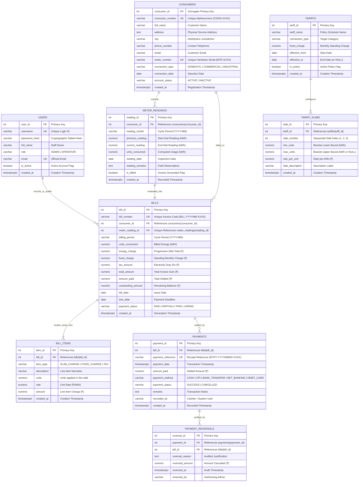

# Entity-Relationship (ER) Diagram & Schema Specifications

## Electricity Billing and Consumption Management System

### 1. Conceptual ER Diagram (Mermaid)

---

### 2. Relationship Cardinalities

| Relationship | Entities Involved | Cardinality | Explanation |
| :--- | :--- | :--- | :--- |
| **Consumer to Meter Readings** | `consumers` $\rightarrow$ `meter_readings` | $1 : N$ (One-to-Many) | One consumer receives multiple monthly meter readings over time. A unique constraint ensures exactly one reading per consumer per billing cycle. |
| **Meter Reading to Bill** | `meter_readings` $\rightarrow$ `bills` | $1 : 1$ (One-to-One) | Each meter reading generates exactly one bill invoice via a UNIQUE foreign key constraint. |
| **Tariff to Slabs** | `tariffs` $\rightarrow$ `tariff_slabs` | $1 : N$ (One-to-Many) | One tariff schedule contains multiple progressive consumption tier slabs (e.g. 0-100, 100-200, >200 units). |
| **Bill to Bill Items** | `bills` $\rightarrow$ `bill_items` | $1 : N$ (One-to-Many) | Each bill is broken down into itemized line entries preserving the progressive slab charges, fixed charges, and taxes. |
| **Bill to Payments** | `bills` $\rightarrow$ `payments` | $1 : N$ (One-to-Many) | Consumers may settle a bill via a single lump sum or multiple partial installment payments. |
| **Payment to Reversal** | `payments` $\rightarrow$ `payment_reversals` | $1 : 1$ (One-to-One audit) | A cancelled payment has at most one reversal entry documenting the cancellation reason. |
